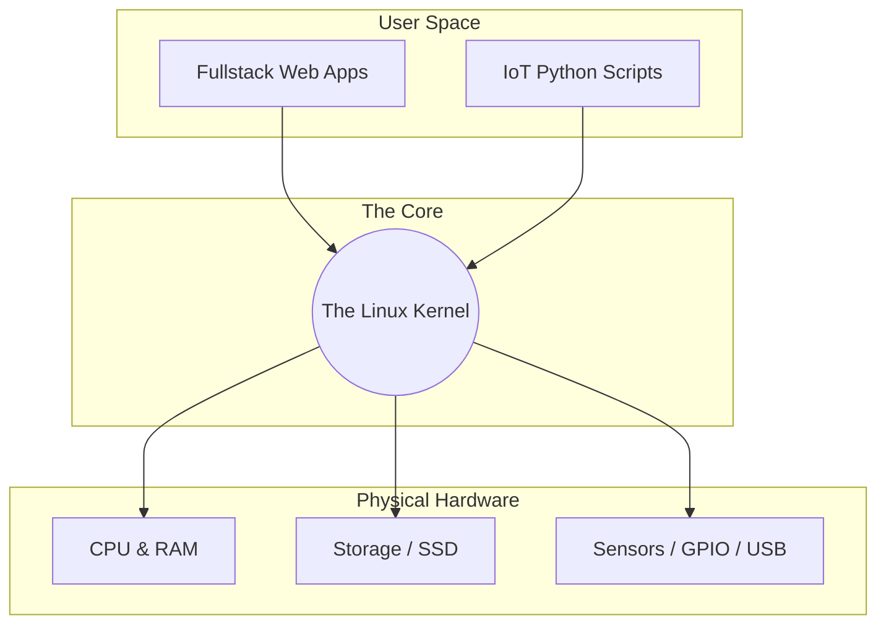
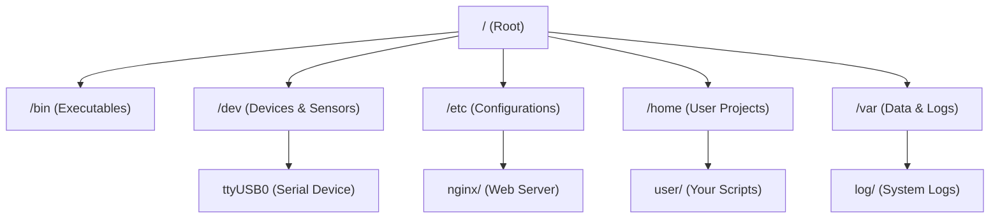

# The Fullstack & IoT Developer's Guide to the OS and File System

Welcome to the practical side of Operating Systems. As a developer, you don't need a theoretical computer science degree to master the OS—you need to know how it runs your web servers, manages your databases, and talks to your sensors. 

We are going to focus on rapid-feedback, application-driven concepts. Let's skip the abstract theory and dive straight into how an OS works, how the file system is laid out, and the exact commands you will use every day to build, test, and debug.

---

## The Operating System (The Ultimate Middleman)

An Operating System (like Linux, Windows, or macOS) sits between your code and the physical hardware. 

When your Node.js backend needs to save a file, or your MicroPython script needs to trigger a relay, your code doesn't manipulate the hardware registers directly. It asks the OS to do it.

### The Architecture

Here is how the layers interact when your code runs:

* **User Space:** This is the safe playground where your web apps, databases, and scripts live. If an application crashes here, the system catches the error and keeps running, providing that immediate error feedback you need to iterate quickly.
* **The Kernel:** The core of the OS. It has absolute power and acts as the traffic cop for the CPU, memory, and devices.
* **Hardware:** The physical silicon. On smaller microcontrollers, you might run MicroPython close to bare metal, but on larger edge devices (like a Raspberry Pi), the Linux kernel manages all these resources.

---

## The Linux File System Hierarchy

In Linux, there is a golden rule: **Everything is a file.**

Your web server's configuration is a file. Your application logs are files. In IoT, even physical sensors, USB ports, and serial connections are represented as files!

### The Directory Tree

When you deploy a fullstack app or configure an edge device, you will constantly interact with these directories:

* `/` **(Root):** The very top of the hierarchy. Everything branches from here.
* `/home`: Where your personal user files and project repositories live (e.g., `/home/dev/my-iot-dashboard`).
* `/etc`: **Crucial for Fullstack.** This is where system-wide configuration files live. If you are setting up a reverse proxy or a background service to keep your scripts running, you edit files here.
* `/var`: Variable data. This is where databases (like PostgreSQL) store their data, and where system logs live (`/var/log`).
* `/dev`: **Crucial for IoT.** Device files. If you plug in a serial sensor or a microcontroller board, it appears here (e.g., `/dev/ttyUSB0`). To read the sensor data, your code literally just reads that "file".

---

## The Developer's Toolkit (Essential OS Commands)

To build software efficiently, you need to live in the terminal. The terminal provides the fastest feedback loop possible. You type a command, you get an immediate result.

Here is the master list of commands you will use daily.

### 1. Navigation & Discovery

These commands help you figure out where you are and what is around you.

* `pwd` **(Print Working Directory):** Shows your exact current location in the file system.
* *Usage:* `pwd` -> Outputs: `/home/dev/projects`

* `ls` **(List):** Shows the contents of a directory.
* *Usage:* `ls` (basic list)
* *Pro-tip:* `ls -la` (Lists ALL files, including hidden `.env` files, with read/write permissions and file sizes).

* `cd` **(Change Directory):** Moves you around the file system.
* *Usage:* `cd /var/log` (Moves to the log folder).
* *Pro-tip:* `cd ..` (Moves up one level). `cd ~` (Jumps straight to your home folder).

* `find` **(Search):** Locates files across the system.
* *Usage:* `find . -name "main.py"` (Finds any file named main.py in your current folder and all subfolders).

### 2. File & Project Manipulation

Commands to quickly create, move, and organize your code.

* `mkdir` **(Make Directory):** Creates a new folder.
* *Usage:* `mkdir iot-backend`

* `touch` **(Create File):** Instantly creates an empty file. Great for scaffolding projects.
* *Usage:* `touch config.json`

* `cp` **(Copy):** Copies files or directories.
* *Usage:* `cp .env.example .env` (Quickly duplicating template files).
* *Pro-tip:* Use `cp -r folder_a folder_b` to copy entire directories recursively.

* `mv` **(Move / Rename):** Moves a file or renames it.
* *Usage:* `mv old_script.py new_script.py` (Renames the file).

* `rm` **(Remove):** Deletes files.
* *Usage:* `rm debug.log`
* *Warning:* `rm -rf node_modules/` deletes a folder and everything inside it permanently. There is no recycle bin in the terminal!

### 3. Reading & Debugging

When your web server crashes or your IoT device throws an error, you need to see the data immediately.

* `cat` **(Concatenate):** Dumps the entire contents of a file to your screen.
* *Usage:* `cat package.json`

* `less` **(Scroll):** Opens a scrollable view for large files instead of flooding your terminal. Press `q` to quit.
* *Usage:* `less large_dataset.csv`

* `tail` **(Read End):** Views the bottom of a file.
* *Usage:* `tail -f /var/log/syslog`
* *Pro-tip:* The `-f` flag "follows" the file. As new errors happen in real-time, they print to your screen instantly. This is the ultimate debugging tool.

* `grep` **(Search Inside Files):** Searches for specific text within files.
* *Usage:* `grep "Error" server.log` (Outputs only the lines containing the word "Error").

### 4. Permissions & Process Management

If your backend app gives you an "Access Denied" error, or your script hangs, you use these.

* `chmod` **(Change Mode):** Modifies file permissions (Read, Write, Execute).
* *Usage:* `chmod +x setup.sh` (Makes a script executable so you can run it).

* `chown` **(Change Owner):** Changes who owns a file.
* *Usage:* `sudo chown www-data:www-data my_app` (Gives the web server permission to access your app folder).

* `top` / `htop` **(Task Manager):** Shows real-time CPU and RAM usage. Use this to see if your script has a memory leak.
* `kill` **(End Process):** Forcibly stops a running program.
* *Usage:* First find the Process ID (PID) using `top`, then run `kill -9 1234` to force-quit it.
