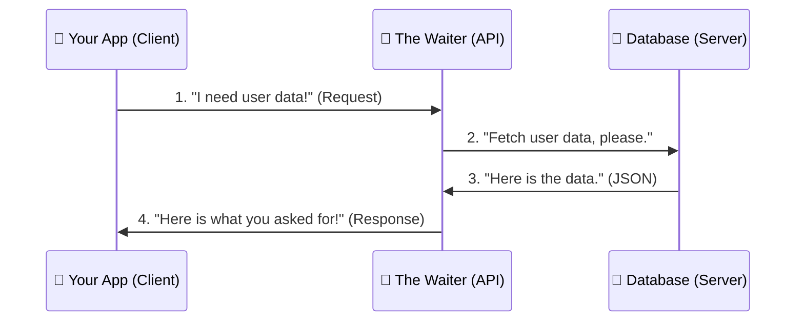
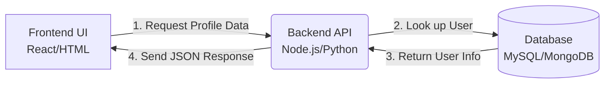

# 🚀 The Beginner's Guide to APIs

Welcome! If you are a student starting your coding journey, you've probably heard the term **API** thrown around a lot. This guide will break down what an API is, how it works, and where it is used in the real world, using simple language and clear diagrams.

## 🧐 What is an API?

**API** stands for **Application Programming Interface**.

Think of an API as a **waiter in a restaurant**.

* **You (The Client/App):** You are sitting at the table with a menu. You know what you want to eat, but you can't go into the kitchen to cook it.
* **The Kitchen (The Server/Database):** This is where all the ingredients are stored and the complex cooking happens.
* **The Waiter (The API):** The waiter takes your order (Request), carries it to the kitchen, waits for the food to be prepared, and brings the food (Response) back to your table.

APIs are simply messengers that allow two different pieces of software to talk to each other safely and easily.

### The Restaurant Flowchart



---

## 🌍 Where are APIs Used? (Real-World Use Cases)

APIs are the glue of the modern internet. Let's look at some popular ways developers use them.

### 1. Web & Backend Development 💻

When you build a website (like an e-commerce store), you usually have a Frontend (what the user sees) and a Backend (the brain/database). The Frontend uses an API to ask the Backend for information, like a list of products.

**Use Case:** Showing a user their profile information on a social media website.



* **Beginner Tip:** Notice how the Frontend never talks *directly* to the Database. The API acts as a secure middleman to make sure hackers can't just delete everything!

### 2. Internet of Things (IoT) 💡

IoT refers to physical devices connected to the internet—like smart bulbs, smartwatches, or smart thermostats. APIs allow your smartphone to control these devices from miles away.

**Use Case:** Turning on your home air conditioning using an app on your phone while you are still at school.

```mermaid
graph TD
    A[📱 Mobile App] -- 1. Send "Turn ON" Request --> B((Cloud API Server))
    B -- 2. Verify User & Route Command --> C[❄️ Smart AC Unit]
    C -- 3. Confirm AC is ON --> B
    B -- 4. Update App Status --> A
    
    style B fill:#f9f,stroke:#333,stroke-width:2px

```

* **Beginner Tip:** The Cloud API Server is the brain in the sky. It receives the command from your phone, translates it, and blasts it down to the AC unit in your house.

### 3. Various Industry Sectors 🏢

APIs aren't just for controlling things; they are amazing for pulling in third-party data so you don't have to write the code yourself!

* **☀️ Weather Sector:**
You want to build a weather app. You don't need to launch a satellite into space! You just use a **Weather API**. Your app asks the API, *"What's the weather in London?"* and the API replies, *"It's 15°C and raining."*
* **💳 Financial Sector (Payment Gateways):**
When you buy something on a website, the website doesn't process your credit card directly. It sends your card details via an API to a service like **Stripe** or **PayPal**, which handles the complex bank security and sends back a simple *"Payment Successful"* message.
* **🤖 Artificial Intelligence (AI):**
Want to add a smart chatbot to your project? You can just send a user's text to an **OpenAI API** or **Google Gemini API**, and it will return a smart AI-generated response directly to your app.

### Sector Data Flowchart

```mermaid
graph LR
    App[Your Cool App]
    
    App -- Requests Weather --> W[Weather API]
    W -. Returns 15°C .-> App
    
    App -- Requests Payment --> P[PayPal API]
    P -. Returns "Success" .-> App
    
    App -- Requests Maps --> M[Google Maps API]
    M -. Returns City Map .-> App

```

---

## 🛠️ What Does API Data Look Like?

When APIs reply to your request, they usually reply in a language called **JSON** (JavaScript Object Notation). It looks like this:

```json
{
  "status": "success",
  "temperature": "15°C",
  "condition": "Raining",
  "city": "London"
}

```

As a coder, you simply write code that looks at this text, grabs the `"15°C"`, and displays it beautifully on your website!

---

## 🎯 Summary for Students

1. **APIs are messengers.** They take a request, tell a system what to do, and bring a response back.
2. **APIs save time.** You don't have to build a payment processor or weather station from scratch; you just borrow someone else's using their API.
3. **APIs keep data safe.** By acting as a middleman, APIs protect databases from direct, unauthorized access.

Keep coding, keep building, and don't be afraid to try connecting your first API! 🚀